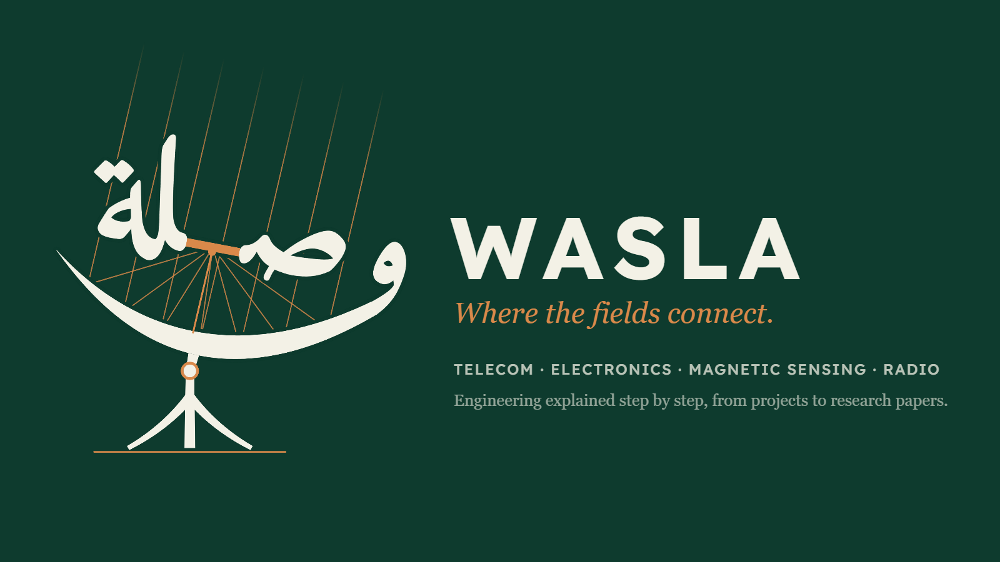

# Dr. Hamzah Naser Mahmood

Electrical and electronic engineer · PhD, Universiti Sains Malaysia (2026)

I work where circuits, sensors and radio meet measurement: how a system behaves, how to measure it, and how far the numbers can be trusted.

## [WASLA | وصلة](https://www.youtube.com/@WaslaEngineering)
My YouTube channel: engineering explained step by step, from real projects to research papers in plain language. Wasla is Arabic for a link: a joint, an electrical connection.

## Background
- **PhD**, Universiti Sains Malaysia (2026): radio propagation, how airborne dust affects short-range radio links.
- **MSc by research**, Universiti Sains Malaysia (2018): low-cost magnetic sensing for civilian safety.
- **BEng (Hons) Electrical and Electronic Engineering**, Northumbria University, at KDU College, Penang (2014).
- **Diploma in Telecommunications Engineering**, INTI International College, Penang (2011).
- **Teaching assistant**, School of Electrical and Electronic Engineering, USM: circuit theory, electromagnetics and calculus.

## Working with
Measurement and instrumentation · sensors and data acquisition · RF propagation measurement · microcontrollers in C (PIC, Arduino) · Python for analysis · VB.NET · Proteus, Multisim, FEMM

## Projects
| Project | About |
|---|---|
| [usb-rc-meter](https://github.com/hamzah-n-mahmood/usb-rc-meter) | A USB resistance and capacitance meter, rebuilt as a video series: worksheets, data, the original firmware and Windows app, and an [interactive dashboard](https://hamzah-n-mahmood.github.io/usb-rc-meter/). |

## Elsewhere
- YouTube: [WASLA | وصلة](https://www.youtube.com/@WaslaEngineering)
- LinkedIn: https://www.linkedin.com/in/hamzah-n-mahmood
- Publications: [ORCID](https://orcid.org/0000-0003-3404-1268) · [Google Scholar](https://scholar.google.com/citations?user=tOwnpfoAAAAJ)
